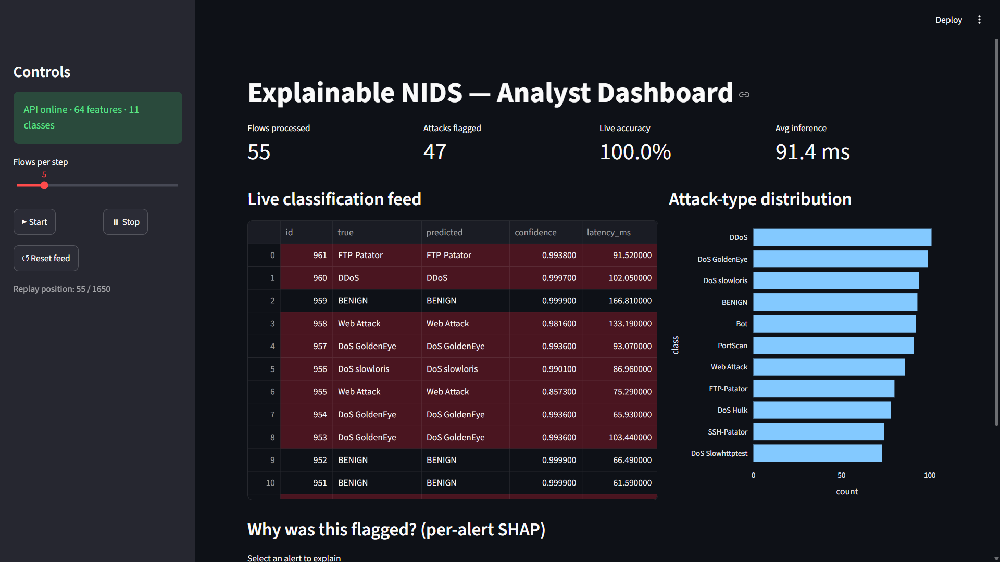

# Explainable AI-Based Network Intrusion Detection System (NIDS)

An end-to-end, explainable intrusion detection system that classifies network
traffic into 11 classes on the **CICIDS2017** benchmark, explains every
prediction with SHAP, and serves it through a live analyst dashboard.

B.Tech Computer Engineering capstone, SVKM's NMIMS MPSTME Shirpur (2026–27).
Team: Gurjot Singh, Lehar Nimodiya, Lokesh Ingale. Mentor: Prof. Naziya Hussain.



## Highlights

- **Stacking ensemble:** Random Forest + XGBoost base learners, Logistic Regression meta-learner.
- **Leakage-free class-imbalance handling:** SMOTE runs *inside each cross-validation fold*, so no synthetic sample reaches the meta-learner's training data.
- **Per-prediction explainability:** SHAP TreeExplainer shows which flow features drove each alert.
- **Deployed, not just trained:** FastAPI inference API, SQLite alert log, real-time Streamlit dashboard.

## Results (held-out test set, 565,566 flows, 11 classes)

| Model | Accuracy | Macro-F1 | Bot recall |
|-------|:--------:|:--------:|:----------:|
| Random Forest (baseline) | 0.998 | 0.956 | 0.499 |
| XGBoost (baseline) | 0.999 | 0.969 | 0.752 |
| **Stacking + within-fold SMOTE** | **0.999** | **0.976** | **0.844** |

- One-vs-rest ROC-AUC 0.9998, macro false-positive rate 1.8×10⁻⁴
- 5-fold CV (300k stratified subsample): macro-F1 0.975 ± 0.003
- Inference ≈ 33 ms per flow; SHAP explanation adds ≈ 7 ms

## Architecture

```
Raw CICIDS2017 flow (78 features)
  -> Preprocessing (clean, drop leakage, scale) -> 64 features, 11 classes
  -> Stacking: [SMOTE -> Random Forest] + [SMOTE -> XGBoost]  (SMOTE inside each CV fold)
       -> out-of-fold probabilities -> Logistic Regression meta-learner -> prediction
  -> SHAP TreeExplainer on the XGBoost base learner -> per-alert explanation
  -> FastAPI backend -> SQLite alert log -> Streamlit dashboard
```

## Project structure

```
src/
  config.py           paths, constants, hyperparameters
  data_loading.py     load + combine the 8 CICIDS2017 CSVs
  preprocessing.py    training pipeline and inference transform
  smote_cv.py         picklable SMOTE floor strategy + within-fold pipeline
  models.py           baselines and the stacking ensemble
  evaluation.py       metrics, per-class FPR, latency, SHAP overhead, CV stability
  explainability.py   SHAP TreeExplainer helpers
scripts/
  train.py            end-to-end training and evaluation
  make_replay_sample.py  balanced replay stream for the dashboard
api/main.py           FastAPI backend
dashboard/app.py      Streamlit dashboard
notebooks/            step-by-step development notebooks (01–06)
tests/                end-to-end smoke test on synthetic data
```

## Running it

The dataset and trained model are not committed (large / licensed).

1. **Install** (Python 3.10+):
   ```bash
   python -m venv .venv
   .venv\Scripts\activate            # Windows (source .venv/bin/activate on Linux/Mac)
   python -m pip install -r requirements.txt
   ```
2. **Data:** download CICIDS2017 (MachineLearningCVE, 8 CSVs) and set `DATA_DIR` in `src/config.py`.
3. **Train and evaluate** (about an hour on a laptop CPU; add `--device cuda` for a GPU):
   ```bash
   python -m scripts.train
   python -m scripts.make_replay_sample
   ```
   Results go to `reports/results.json`; the model goes to `models/`.
4. **Serve:**
   ```bash
   python -m uvicorn api.main:app              # terminal 1, API at :8000
   python -m streamlit run dashboard/app.py    # terminal 2, dashboard at :8501
   ```
5. **Test:** `python -m pytest -q`

## Dataset

CICIDS2017 (Canadian Institute for Cybersecurity), MachineLearningCVE version:
about 2.83M flows, 78 features. The Web Attack subtypes are merged into one class,
and Heartbleed (11 flows) and Infiltration (36 flows) are excluded as too sparse to
train or evaluate reliably, giving 11 classes.

## Limitations

Evaluated on one dataset (CICIDS2017, a controlled testbed); the dashboard replays
pre-computed flow features rather than capturing live packets; SHAP explains the
XGBoost base learner rather than the full stack. This is a research prototype,
not a production-hardened security appliance.
